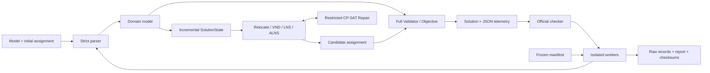

# GMRP-ALNS

English | [简体中文](README_zh.md)

GMRP-ALNS is a reproducible research implementation for the
[ROADEF/EURO Challenge 2012 Machine Reassignment Problem](https://roadef.org/challenge/2012/en/).
It combines an independently implemented validator and objective evaluator with an incremental
move engine, local search, adaptive large-neighborhood search, and bounded Restricted CP-SAT
Repair. A preregistered, fully traceable A/B short-budget study records both positive and negative
findings; it does not claim competition-level performance.
A classic Generalized Assignment Problem (GAP) track provides a smaller exact and heuristic baseline.

> **Status:** v1.0.0 research release, M0–M8 complete. The GMRP parser, full validator/objective,
> incremental relocate/swap state, first/best local search, VND, random-removal LNS, Adaptive
> ALNS, periodic Restricted CP-SAT Repair, and the classic GAP exact/heuristic track are present.
> M7's frozen 660-observation study, raw archive, figures and technical verification are complete.

## Scope

The current code reads the official integer-stream instance format and assignment format,
checks capacity, conflict, spread, dependency, and transient-usage constraints, and computes
all official objective components. Cached GMRP state supports feasibility checks, exact objective
deltas, apply/undo, and Top-K relocate candidates. Search supports strict-feasible first/best
relocate improvement, relocate/swap VND, random removal, and Adaptive ALNS with five destroy and
three repair operators, simulated annealing, adaptive weights, and restart under a shared seed and
time-limit protocol. An optional periodic exact repair fixes the complement of a destroyed
neighborhood, caps candidate assignment variables and local solver time, models every official
constraint and objective component, and writes back only a full-oracle-verified improvement. The
GAP track supports the OR-Library format, CP-SAT,
cost/regret construction, repair, relocate, and swap. It deliberately does not copy a competition
entry or claim unmeasured performance.

## Evidence at a glance

| Evidence | Verified result | Trace |
|---|---|---|
| Official cross-check | All ten A1/A2 initial feasibility and objective values match the checker | `docs/m1_verification.md` |
| Incremental correctness | 10,000 seeded legal moves match the full oracle, including undo | `docs/m2_m3_verification.md` |
| GAP exact baseline | All five OR-Library `gap1` reference values reproduced | `docs/m2_m3_verification.md` |
| Frozen M7 study | 660/660 returned assignments are project-valid and official-valid | `results/m7/records.jsonl` |
| M7 mean improvement | Relocate 12.032%, VND 12.008%, ALNS 9.126%, Restricted 8.994% | `results/m7/summary.json` |
| Timing limitation | 208/660 solver calls exceed the preregistered 1.1-second tolerance | `docs/m7_verification.md` |

The short-budget result is intentionally negative for added complexity: Relocate and VND
outperform ALNS on this host at a requested one-second budget, while Restricted Repair is nearly
neutral. It is not evidence about longer budgets or competition-level performance.

## Architecture



The incremental engine supplies speed; the independent full validator and objective remain the
correctness authority. See [Architecture and execution flows](docs/architecture.md) for module,
solver and experiment diagrams.

## Quick start

Python 3.11 or newer is required.

```powershell
python -m venv .venv
.\.venv\Scripts\python.exe -m pip install -e ".[dev]"
.\.venv\Scripts\python.exe scripts/demo.py
```

The one-command demo uses only committed toy data. It parses, validates and scores GMRP; runs a
fixed-seed/fixed-iteration Restricted ALNS search; revalidates the written candidate; and proves
the bundled GAP optimum. A successful run reports `"status": "ok"`, GMRP cost `2411`, and GAP
cost `8`. On macOS/Linux, use `./.venv/bin/python` in place of the Windows Python path.
Later snippets that start with `python` assume the virtual environment is activated; otherwise use
the explicit interpreter path shown above.

Run the bundled official-format toy example:

```powershell
.\.venv\Scripts\python.exe -m gmrp_alns parse data/toy/model_toy.txt
.\.venv\Scripts\python.exe -m gmrp_alns validate `
  data/toy/model_toy.txt data/toy/assignment_toy.txt data/toy/solution_toy.txt
.\.venv\Scripts\python.exe -m gmrp_alns score `
  data/toy/model_toy.txt data/toy/assignment_toy.txt data/toy/solution_toy.txt
.\.venv\Scripts\python.exe -m gmrp_alns solve `
  data/toy/model_toy.txt data/toy/assignment_toy.txt `
  --algorithm adaptive-alns --time-limit 2 --seed 42 --output candidate.sol
.\.venv\Scripts\python.exe -m gmrp_alns solve `
  data/toy/model_toy.txt data/toy/assignment_toy.txt `
  --algorithm adaptive-alns-restricted --time-limit 2 --seed 42 --output candidate-m6.sol
.\.venv\Scripts\python.exe -m gmrp_alns gap parse `
  data/toy/gap_toy.txt --sense minimize
.\.venv\Scripts\python.exe -m gmrp_alns gap solve `
  data/toy/gap_toy.txt --sense minimize --algorithm exact --reference-value 8
```

The toy optimized assignment has official example cost `2411`. Commands emit JSON so they
can be used by tests and experiment scripts. Validation returns exit code `0` for a feasible
solution and `1` for an infeasible solution; malformed input returns `2`.

## Data and reproducibility

External benchmark files are not committed. See [data/README.md](data/README.md) for official
sources and expected placement. `data/raw/` and generated run outputs are ignored by Git.
Every published result must retain its configuration, seed, time limit, environment, and raw
output. M7's committed archive is under [results/m7](results/m7), and every result number below is
traceable to its JSONL/CSV/JSON files and checksums.

## Project documents

- [中文输入输出与快速上手指南](docs/getting_started_zh.md)
- [Project knowledge and conversation log](QA.md)
- [Project plan](docs/project_plan.md)
- [Mathematical model](docs/mathematical_model.md)
- [Architecture and execution flows](docs/architecture.md)
- [Experiment protocol](docs/experiment_protocol.md)
- [Reproducibility](docs/reproducibility.md)
- [M1 verification record](docs/m1_verification.md)
- [M2–M3 verification record](docs/m2_m3_verification.md)
- [M4 verification record](docs/m4_verification.md)
- [M5 verification record](docs/m5_verification.md)
- [M6 verification record](docs/m6_verification.md)
- [M7 preregistration](docs/m7_protocol.md)
- [M7 verification and interpretation](docs/m7_verification.md)
- [M7 generated report](results/m7/report.md)
- [v1.0.0 release notes](docs/release_notes_v1.0.0.md)
- [v1.0.0 release audit](docs/release_audit_v1.0.0.md)
- [2–3 minute demo recording script](docs/demo_video_zh.md)
- [Evidence-backed resume and interview material](docs/portfolio_zh.md)
- [Roadmap](ROADMAP.md)
- [Third-party sources](THIRD_PARTY.md)

## License

Project-authored source code is available under the MIT License. External data, papers, and
tools retain their own terms; see [THIRD_PARTY.md](THIRD_PARTY.md).

## Official A-set cross-check

The A files remain ignored, but their source URLs and SHA-256 hashes are committed in
`data/manifests/`. To reproduce the M1 cross-check:

```bash
python data/download_roadef.py a1
python data/download_roadef.py a2
python data/download_roadef.py checker
g++ data/raw/roadef/checker/solution_checker.cc data/raw/roadef/checker/solution_checker_run.cc -O2 -std=c++11 -o data/raw/roadef/checker/solution_checker
python scripts/crosscheck_official_dataset.py data/raw/roadef/checker/solution_checker data/raw/roadef/a1
python scripts/crosscheck_official_dataset.py data/raw/roadef/checker/solution_checker data/raw/roadef/a2
```

## M2–M3 verification

OR-Library stores the objective direction outside the integer data stream. Pass it explicitly:

```bash
python data/download_orlib.py gap1
python scripts/verify_gap_reference.py data/manifests/orlib_gap1.json --time-limit 10 --seed 42
```

The recorded M2 run reproduced all five official `gap1` maximization reference values. The M3
property test applies and undoes 10,000 seeded legal moves against the full validator/objective.
An additional recorded A1_2 run checked 10,000 legal relocate deltas and measured 111.94x higher
evaluation throughput than full validation plus objective recomputation on that machine:

```bash
python scripts/benchmark_incremental.py \
  data/raw/roadef/a1/model_a1_2.txt \
  data/raw/roadef/a1/assignment_a1_2.txt \
  --samples 10000 --seed 42
```

This is a development-machine measurement, not a cross-machine performance claim; full details
and limitations are in the M2–M3 verification record.

## M4 verification

The committed M4 verification command runs one-second seeded VND searches on all local A1/A2
instances, then checks every emitted assignment with both project oracles and the unmodified
official checker:

```bash
python scripts/verify_m4_a_set.py \
  data/raw/roadef/checker/solution_checker \
  data/raw/roadef/a1 data/raw/roadef/a2 \
  --algorithm vnd-first --time-limit 1 --seed 42
```

The recorded development run improved all ten initial assignments and all ten final objective
values matched the official checker. This is an M4 acceptance check, not a competitive benchmark;
see the M4 verification record for the exact results and limitations.

## M5 verification

The frozen M5 development configuration compares Random LNS and Adaptive ALNS over three A
instances and three seeds under equal one-second budgets. The recorded run produced six Adaptive
ALNS wins in nine pairs and a 416,047,975 lower summed objective; all 18 assignments passed the
official checker. A separate feasibility gate verified all ten A1/A2 instances plus B1/B2:

```bash
python scripts/verify_m5_development.py configs/m5_development.json \
  data/raw/roadef/checker/solution_checker data/raw/roadef
python scripts/verify_m5_feasibility.py \
  data/raw/roadef/checker/solution_checker data/raw/roadef/b \
  --time-limit 1 --seed 42 --instances b_1 b_2
```

These are machine-dependent M5 engineering gates, not the preregistered M7 benchmark. See the M5
verification record for the frozen criteria, configuration revision, results, and limitations.

## M6 verification

The M6 ablation compares Adaptive ALNS with exact repair disabled and enabled under equal
one-second budgets on the same three A instances and three seeds. Restricted calls begin at the
first ALNS iteration and then occur every ten iterations; each call uses one CP-SAT worker, at most
100 assignment variables, at most ten candidate machines per removed process, and a 0.05-second
local budget:

```bash
python scripts/verify_m6_development.py configs/m6_development.json \
  data/raw/roadef/checker/solution_checker.exe data/raw/roadef
```

The recorded run produced five hybrid wins, three ties, and one loss, with a 22,192,222 lower
summed objective. All 135 exact calls respected the configured limits, 83 yielded a verified
current-solution improvement, and all 18 final assignments matched the unmodified official
checker. These machine-dependent development results are not the M7 benchmark; see the M6
verification record for the full table and limitations.

## M7 preregistered short-budget study

The frozen M7 matrix contains 20 A/B instances, five seeds, six main methods and three fixed
ablations on four instances: 660 isolated, serial observations with a requested one-second search
budget. All 660 returned assignments passed both full project validation and the unmodified
official checker, with no failed or missing records.

Relocate and VND produced the strongest mean relative improvement over the initial assignment
(12.032% and 12.008%); Adaptive ALNS reached 9.126%, and Restricted Repair reached 8.994%. In
paired comparison, Relocate and VND beat/tied/lost against ALNS in 72/10/18 and 74/8/18 cases.
Restricted Repair was nearly neutral at 32/35/33 with a -0.131 percentage-point mean gain. These
are negative findings for added complexity at this budget, not a longer-budget conclusion.

The requested budget was not a strict deadline: 208/660 complete solver calls exceeded the
preregistered 1.1-second tolerance. In particular, none of the 40 held-out B3–B10 ALNS/Restricted
pairs had both observations within tolerance. The archive therefore retains actual solver and
process times, failure denominators, memory, checker output and sensitivity counts instead of
describing every returned result as a strict one-second result. Full tables, ablation caveats,
profiling, environment and reproduction commands are in the
[M7 verification record](docs/m7_verification.md).
