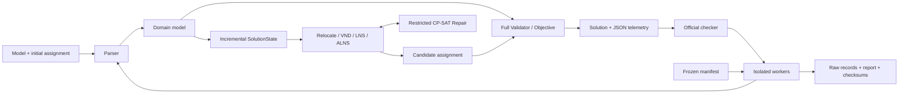

# GMRP-ALNS

[English](README.md) | 简体中文

GMRP-ALNS 是面向 ROADEF/EURO Challenge 2012 Machine Reassignment Problem 的可复现研究
实现。项目从独立 Parser、全量 Validator 和官方目标函数出发，逐步构建增量状态、局部搜索、
VND、LNS、Adaptive ALNS，以及受变量数和局部时限约束的 Restricted CP-SAT Repair；另有
经典 Generalized Assignment Problem（GAP）精确与启发式基线。

> **状态：v1.0.0 研究发布。** M0～M8 已完成。项目强调正确性、可追溯性和诚实报告；不声称
> 达到竞赛最优，也不把超过实际时限的返回结果描述为严格一秒结果。

## 项目解决什么问题

输入是官方 model 与初始 assignment；输出为每个进程选择一台最终机器。解必须满足：

1. machine capacity；
2. 同一 service 的进程不能同机；
3. service 的最小 location 覆盖；
4. neighborhood 层面的 service dependency；
5. transient resource 在迁出和迁入机器上的双端占用。

合法解同时最小化 load、balance、process move、service move 和 machine move 五类加权成本。
完整公式见 [数学模型](docs/mathematical_model.md)。

## 核心证据

| 证据 | 已验证结果 | 可追溯位置 |
|---|---|---|
| 正确性 | 官方 A1/A2 十个初始解的可行性和成本均与官方 checker 一致 | `docs/m1_verification.md` |
| 增量状态 | 10,000 次随机合法 move 的 delta、apply、undo 与全量 oracle 一致 | `docs/m2_m3_verification.md` |
| GAP 精确基线 | OR-Library `gap1` 五个参考最优值全部复现 | `docs/m2_m3_verification.md` |
| M7 冻结实验 | 660/660 个最终解通过全量 Validator 和官方 checker | `results/m7/records.jsonl` |
| M7 一秒档质量 | Relocate 12.032%、VND 12.008%、ALNS 9.126%、Restricted 8.994% 平均改善 | `results/m7/summary.json` |
| 时限限制 | 208/660 次 solver 调用超过预注册的 1.1 秒容差 | `docs/m7_verification.md` |

M7 的结论是：在本机一秒请求预算下，简单 Relocate/VND 比 ALNS 更强，Restricted Repair
没有带来稳定收益。这是对复杂方法的负面结果，不代表 10/60/300 秒预算下仍然如此。

## 架构



增量引擎负责速度，全量 Validator/Objective 负责正确性；任何搜索或精确修复结果在输出前都
必须经过全量 oracle。完整模块边界与实验流程见 [架构说明](docs/architecture.md)。

## 十分钟快速开始

需要 Python 3.11 或更高版本。Windows PowerShell：

```powershell
git clone https://github.com/fengmaker/GMRP-ALNS.git
cd GMRP-ALNS
python -m venv .venv
.\.venv\Scripts\python.exe -m pip install -e ".[dev]"
.\.venv\Scripts\python.exe scripts/demo.py
```

macOS/Linux 将最后两条中的 Python 路径替换为 `./.venv/bin/python`。演示完全使用仓库内的
toy 数据，不需要下载官方实例；它会依次解析、验证、计分、运行固定 seed/迭代数的 GMRP
搜索、再次验证候选解，并复现 GAP toy 最优值。成功时最后输出 `"status": "ok"`、GMRP
成本 `2411` 和 GAP 成本 `8`。

常用命令：

```powershell
.\.venv\Scripts\python.exe -m gmrp_alns validate `
  data/toy/model_toy.txt data/toy/assignment_toy.txt data/toy/solution_toy.txt
.\.venv\Scripts\python.exe -m gmrp_alns solve `
  data/toy/model_toy.txt data/toy/assignment_toy.txt `
  --algorithm adaptive-alns-restricted --time-limit 2 --seed 42 --output candidate.sol
.\.venv\Scripts\python.exe -m pytest
```

更详细的文件格式、字段映射、代码阅读顺序和 Python 示例见
[中文快速上手指南](docs/getting_started_zh.md)。

## 数据与复现

官方 A/B、OR-Library 数据和 checker 不随仓库分发，下载到被 Git 忽略的 `data/raw/`。
下载脚本会记录 URL、时间、大小与 SHA-256；详见 [数据说明](data/README.md)。M7 归档包含
manifest、660 行原始 JSONL、汇总 CSV/JSON、算子统计、三张图、profile 与校验和，报告可
在无外部数据时从归档重新生成。

## 文档导航

- [架构与执行流程](docs/architecture.md)
- [数学模型](docs/mathematical_model.md)
- [算法说明](docs/algorithm.md)
- [M7 预注册](docs/m7_protocol.md)
- [M7 结果、环境与限制](docs/m7_verification.md)
- [复现说明](docs/reproducibility.md)
- [v1.0.0 Release Notes](docs/release_notes_v1.0.0.md)
- [v1.0.0 发布审计](docs/release_audit_v1.0.0.md)
- [2～3 分钟演示录屏脚本](docs/demo_video_zh.md)
- [证据化简历表述与面试问答](docs/portfolio_zh.md)

## 已知限制

- M7 只在一台 Windows 主机上运行一秒请求预算，没有 BKS gap、显著性检验或竞赛程序对比；
- search deadline 是协作式截止，完整 solver 调用可能在一次操作和最终 oracle 后超时；
- B3～B10 的 ALNS/Restricted 配对没有双方都在 1.1 秒容差内的样本；
- `no-restart` 消融未达到 restart 触发轮数，因此不能解释为关闭 restart 的因果收益；
- 外部数据的再分发许可未确认，所以仓库只提交下载器、来源和哈希。

项目源码采用 MIT License；第三方资源保留各自条款，见 [THIRD_PARTY.md](THIRD_PARTY.md)。
