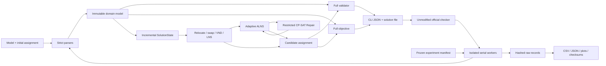
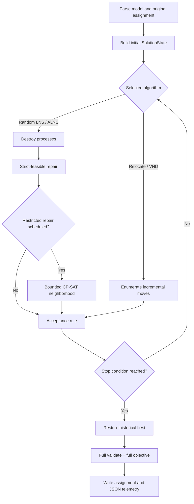
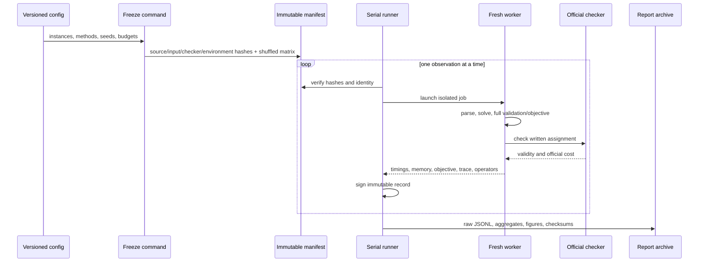

# Architecture and execution flows

## Design rule

The project keeps input parsing, domain semantics, full correctness oracles, incremental state,
search, exact repair, interfaces, and experiments separate. The full validator and objective are
the authority; faster incremental or exact-neighborhood code may optimize a candidate but may not
redefine correctness.

Arrows point from orchestration toward lower-level capabilities. `validator.py` and
`objective.py` do not import search or experiment modules. `SolutionState` mirrors their semantics
but is continuously compared with them in randomized tests.

## Candidate-solution flow

Every heuristic repair is strict-feasible. Adaptive ALNS may accept a worse current state under
simulated annealing, but it protects the historical best. Restricted Repair fixes all processes
outside a small neighborhood, keeps the incumbent in each candidate domain, uses one CP-SAT
worker, and returns nothing on timeout, infeasibility, no improvement, or full-oracle rejection.

## Experiment and evidence flow

Missing, infeasible, rejected, timed-out, and over-budget observations remain visible. Resume skips
only a completed record whose identity and manifest hash still match. M7's committed archive can
regenerate its report without the external benchmark files.

## Module responsibilities

| Layer | Main paths | Responsibility |
|---|---|---|
| Domain and I/O | `gmrp/model.py`, `gmrp/parser.py` | Immutable objects and strict official-format parsing |
| Correctness oracles | `gmrp/validator.py`, `gmrp/objective.py` | Five hard constraints and five official cost terms |
| Incremental engine | `gmrp/state.py` | Cached feasibility, exact deltas, apply/undo and candidate ranking |
| Search | `search/` | Local search, VND, LNS, ALNS, acceptance and operator adaptation |
| Exact neighborhood | `exact/restricted_repair.py` | Bounded fixed-complement CP-SAT repair with safe fallback |
| Classic baseline | `gap/` | OR-Library parsing, CP-SAT and constructive/local GAP methods |
| Interface | `cli.py` | JSON commands and official assignment output |
| Experiments | `experiments/` | Freeze, isolated execution, provenance, aggregation and plots |
| Independent evidence | `tests/`, `scripts/`, `results/m7/` | Oracle comparisons, checker cross-checks and frozen results |

## Trust and failure boundaries

- External benchmark data and the checker stay under ignored `data/raw/`; only download provenance
  and hashes are version controlled.
- The official checker is an independent executable and is never imported as project logic.
- Worker exceptions, watchdog timeouts and checker rejection become failed records, never silent
  initial-solution substitutions.
- Search deadlines are cooperative. Reports distinguish requested budget, measured solver call,
  verification and process time instead of claiming a hard deadline.
- Restricted CP-SAT counters are not combined with heuristic move counts as if they were the same
  unit of work.
