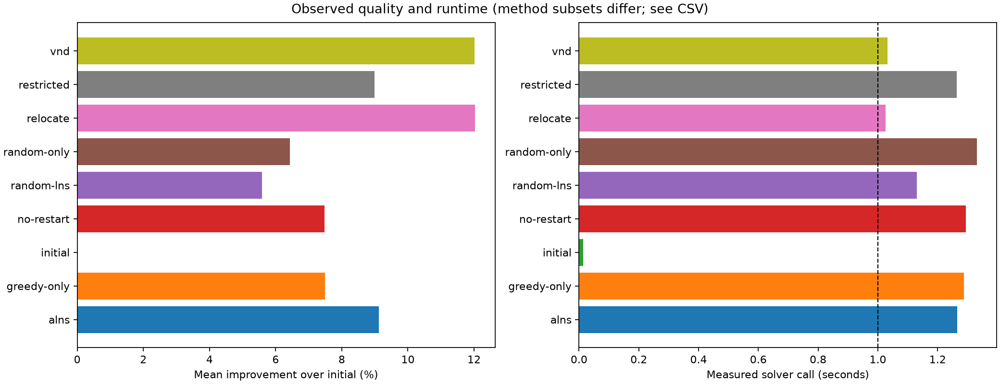
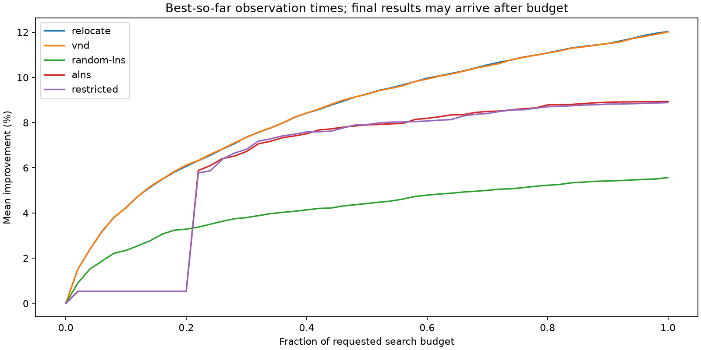
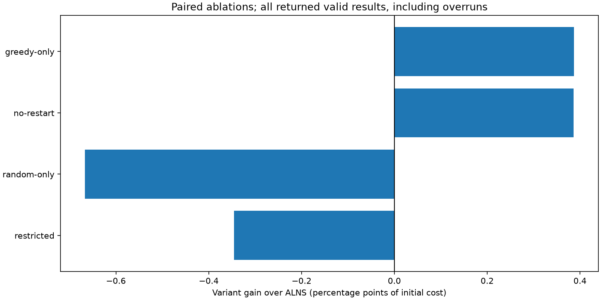

# M7 generated results

Source commit: `ee29875c39c111c0b2a651e56450829b6f376599`.

Expected 660 runs; recorded 660; official-valid 660.

All statistics use valid returned results; overruns remain visible. Initial repeats are deterministic controls, not independent stochastic evidence.

| Instance | Method | n/expected | Mean cost | SD | Improvement % | Overruns |
|---|---|---:|---:|---:|---:|---:|
| a1_1 | alns | 5/5 | 44,307,107.000 | 311.303 | 10.543 | 0 |
| a1_1 | initial | 5/5 | 49,528,750.000 | 0.000 | 0.000 | 0 |
| a1_1 | random-lns | 5/5 | 44,306,947.400 | 434.766 | 10.543 | 0 |
| a1_1 | relocate | 5/5 | 44,307,107.000 | 311.303 | 10.543 | 0 |
| a1_1 | restricted | 5/5 | 44,307,086.800 | 306.348 | 10.543 | 0 |
| a1_1 | vnd | 5/5 | 44,306,945.400 | 331.920 | 10.543 | 0 |
| a1_2 | alns | 5/5 | 899,518,367.200 | 8,364,017.952 | 15.272 | 0 |
| a1_2 | greedy-only | 5/5 | 888,862,885.200 | 9,619,425.238 | 16.275 | 0 |
| a1_2 | initial | 5/5 | 1,061,649,570.000 | 0.000 | 0.000 | 0 |
| a1_2 | no-restart | 5/5 | 898,884,572.400 | 8,094,018.572 | 15.331 | 0 |
| a1_2 | random-lns | 5/5 | 905,369,898.200 | 37,291,920.090 | 14.720 | 0 |
| a1_2 | random-only | 5/5 | 893,645,433.200 | 10,854,003.910 | 15.825 | 0 |
| a1_2 | relocate | 5/5 | 879,218,327.600 | 7,637,505.450 | 17.184 | 0 |
| a1_2 | restricted | 5/5 | 892,984,897.800 | 17,691,223.384 | 15.887 | 0 |
| a1_2 | vnd | 5/5 | 879,668,376.400 | 7,626,119.774 | 17.141 | 0 |
| a1_3 | alns | 5/5 | 583,422,694.800 | 62,400.080 | 0.041 | 0 |
| a1_3 | initial | 5/5 | 583,662,270.000 | 0.000 | 0.000 | 0 |
| a1_3 | random-lns | 5/5 | 583,662,270.000 | 0.000 | 0.000 | 0 |
| a1_3 | relocate | 5/5 | 583,422,634.400 | 62,382.419 | 0.041 | 0 |
| a1_3 | restricted | 5/5 | 583,422,694.800 | 62,400.080 | 0.041 | 0 |
| a1_3 | vnd | 5/5 | 583,422,634.400 | 62,382.419 | 0.041 | 0 |
| a1_4 | alns | 5/5 | 498,149,266.000 | 33,240,950.267 | 21.241 | 0 |
| a1_4 | initial | 5/5 | 632,499,600.000 | 0.000 | 0.000 | 0 |
| a1_4 | random-lns | 5/5 | 625,874,281.600 | 8,434,454.422 | 1.047 | 0 |
| a1_4 | relocate | 5/5 | 380,468,351.800 | 16,131,007.654 | 39.847 | 0 |
| a1_4 | restricted | 5/5 | 486,476,685.600 | 33,702,744.865 | 23.087 | 0 |
| a1_4 | vnd | 5/5 | 383,337,329.400 | 15,108,025.180 | 39.393 | 0 |
| a1_5 | alns | 5/5 | 728,709,596.200 | 2,481,799.230 | 6.837 | 0 |
| a1_5 | initial | 5/5 | 782,189,690.000 | 0.000 | 0.000 | 0 |
| a1_5 | random-lns | 5/5 | 728,122,630.000 | 957,915.721 | 6.912 | 0 |
| a1_5 | relocate | 5/5 | 729,696,491.400 | 2,289,570.815 | 6.711 | 0 |
| a1_5 | restricted | 5/5 | 727,587,280.400 | 3,496.714 | 6.981 | 0 |
| a1_5 | vnd | 5/5 | 729,441,782.400 | 2,323,225.362 | 6.744 | 0 |
| a2_1 | alns | 5/5 | 101,795,053.000 | 15,369,667.278 | 73.978 | 0 |
| a2_1 | initial | 5/5 | 391,189,190.000 | 0.000 | 0.000 | 0 |
| a2_1 | random-lns | 5/5 | 172,022,549.000 | 16,156,218.574 | 56.026 | 0 |
| a2_1 | relocate | 5/5 | 151,959,367.400 | 19,301,268.744 | 61.155 | 0 |
| a2_1 | restricted | 5/5 | 114,456,812.600 | 16,099,768.145 | 70.741 | 0 |
| a2_1 | vnd | 5/5 | 152,872,386.800 | 17,990,203.374 | 60.921 | 0 |
| a2_2 | alns | 5/5 | 1,624,818,669.000 | 48,174,817.969 | 13.425 | 0 |
| a2_2 | initial | 5/5 | 1,876,768,120.000 | 0.000 | 0.000 | 0 |
| a2_2 | random-lns | 5/5 | 1,639,198,626.200 | 134,964,352.131 | 12.658 | 0 |
| a2_2 | relocate | 5/5 | 1,507,927,213.400 | 18,577,456.663 | 19.653 | 0 |
| a2_2 | restricted | 5/5 | 1,621,631,259.000 | 31,930,822.133 | 13.594 | 0 |
| a2_2 | vnd | 5/5 | 1,504,804,165.800 | 18,534,442.599 | 19.819 | 0 |
| a2_3 | alns | 5/5 | 2,022,192,500.000 | 38,914,818.919 | 11.014 | 0 |
| a2_3 | greedy-only | 5/5 | 2,012,794,930.000 | 45,495,092.645 | 11.428 | 0 |
| a2_3 | initial | 5/5 | 2,272,487,840.000 | 0.000 | 0.000 | 0 |
| a2_3 | no-restart | 5/5 | 1,992,982,510.800 | 53,911,026.309 | 12.300 | 0 |
| a2_3 | random-lns | 5/5 | 2,174,910,864.600 | 89,046,847.451 | 4.294 | 0 |
| a2_3 | random-only | 5/5 | 2,055,133,530.600 | 56,364,115.630 | 9.565 | 0 |
| a2_3 | relocate | 5/5 | 1,897,598,139.200 | 33,745,035.538 | 16.497 | 0 |
| a2_3 | restricted | 5/5 | 2,025,366,943.200 | 46,950,026.720 | 10.874 | 0 |
| a2_3 | vnd | 5/5 | 1,898,492,154.200 | 31,264,130.088 | 16.458 | 0 |
| a2_4 | alns | 5/5 | 2,825,121,660.200 | 38,762,683.876 | 12.359 | 0 |
| a2_4 | initial | 5/5 | 3,223,516,130.000 | 0.000 | 0.000 | 0 |
| a2_4 | random-lns | 5/5 | 3,144,014,636.800 | 68,368,620.936 | 2.466 | 0 |
| a2_4 | relocate | 5/5 | 2,481,697,793.400 | 61,837,667.285 | 23.013 | 0 |
| a2_4 | restricted | 5/5 | 2,844,315,530.400 | 82,515,915.773 | 11.764 | 0 |
| a2_4 | vnd | 5/5 | 2,473,248,985.800 | 71,016,803.799 | 23.275 | 0 |
| a2_5 | alns | 5/5 | 734,536,615.200 | 8,288,064.174 | 6.708 | 0 |
| a2_5 | initial | 5/5 | 787,355,300.000 | 0.000 | 0.000 | 0 |
| a2_5 | random-lns | 5/5 | 783,786,825.600 | 4,535,514.382 | 0.453 | 0 |
| a2_5 | relocate | 5/5 | 678,462,431.200 | 6,512,705.888 | 13.830 | 0 |
| a2_5 | restricted | 5/5 | 736,813,575.600 | 5,000,037.002 | 6.419 | 0 |
| a2_5 | vnd | 5/5 | 678,755,269.600 | 6,263,583.585 | 13.793 | 0 |
| b_1 | alns | 5/5 | 7,350,011,674.200 | 305,007,883.434 | 3.848 | 0 |
| b_1 | initial | 5/5 | 7,644,173,180.000 | 0.000 | 0.000 | 0 |
| b_1 | random-lns | 5/5 | 7,574,199,449.400 | 47,010,782.462 | 0.915 | 0 |
| b_1 | relocate | 5/5 | 6,761,758,339.000 | 113,526,774.879 | 11.544 | 0 |
| b_1 | restricted | 5/5 | 7,291,926,564.600 | 403,639,771.031 | 4.608 | 0 |
| b_1 | vnd | 5/5 | 6,760,568,549.400 | 146,578,710.035 | 11.559 | 0 |
| b_10 | alns | 5/5 | 42,220,868,760.000 | 0.000 | 0.000 | 5 |
| b_10 | initial | 5/5 | 42,220,868,760.000 | 0.000 | 0.000 | 0 |
| b_10 | random-lns | 5/5 | 42,215,818,733.800 | 11,292,201.871 | 0.012 | 5 |
| b_10 | relocate | 5/5 | 42,220,130,352.800 | 1,070,566.223 | 0.002 | 5 |
| b_10 | restricted | 5/5 | 42,220,868,760.000 | 0.000 | 0.000 | 5 |
| b_10 | vnd | 5/5 | 42,220,130,352.800 | 1,070,566.223 | 0.002 | 5 |
| b_2 | alns | 5/5 | 5,058,295,055.600 | 23,546,335.042 | 2.378 | 0 |
| b_2 | initial | 5/5 | 5,181,493,830.000 | 0.000 | 0.000 | 0 |
| b_2 | random-lns | 5/5 | 5,160,413,225.800 | 29,077,920.213 | 0.407 | 0 |
| b_2 | relocate | 5/5 | 4,306,669,716.400 | 134,327,630.673 | 16.884 | 0 |
| b_2 | restricted | 5/5 | 5,064,410,804.000 | 31,757,661.391 | 2.260 | 0 |
| b_2 | vnd | 5/5 | 4,319,056,556.600 | 116,041,811.924 | 16.645 | 0 |
| b_3 | alns | 5/5 | 6,203,091,286.000 | 207,110,930.072 | 2.111 | 5 |
| b_3 | greedy-only | 5/5 | 6,194,770,288.400 | 201,517,831.418 | 2.242 | 5 |
| b_3 | initial | 5/5 | 6,336,834,660.000 | 0.000 | 0.000 | 0 |
| b_3 | no-restart | 5/5 | 6,190,476,497.600 | 201,434,973.439 | 2.310 | 5 |
| b_3 | random-lns | 5/5 | 6,321,888,051.800 | 11,100,068.894 | 0.236 | 5 |
| b_3 | random-only | 5/5 | 6,315,372,544.000 | 15,402,852.433 | 0.339 | 5 |
| b_3 | relocate | 5/5 | 6,219,382,267.200 | 47,926,527.755 | 1.853 | 0 |
| b_3 | restricted | 5/5 | 6,320,887,694.800 | 15,757,313.240 | 0.252 | 5 |
| b_3 | vnd | 5/5 | 6,220,042,055.800 | 59,909,412.774 | 1.843 | 0 |
| b_4 | alns | 5/5 | 9,061,962,236.400 | 141,064,868.283 | 1.603 | 5 |
| b_4 | initial | 5/5 | 9,209,576,380.000 | 0.000 | 0.000 | 0 |
| b_4 | random-lns | 5/5 | 9,157,794,230.000 | 31,373,697.695 | 0.562 | 2 |
| b_4 | relocate | 5/5 | 9,177,446,427.000 | 19,965,340.814 | 0.349 | 0 |
| b_4 | restricted | 5/5 | 9,066,922,197.200 | 127,710,171.739 | 1.549 | 5 |
| b_4 | vnd | 5/5 | 9,177,446,427.000 | 19,965,340.814 | 0.349 | 1 |
| b_5 | alns | 5/5 | 12,426,813,010.000 | 0.000 | 0.000 | 5 |
| b_5 | initial | 5/5 | 12,426,813,010.000 | 0.000 | 0.000 | 0 |
| b_5 | random-lns | 5/5 | 12,422,783,939.800 | 5,135,880.790 | 0.032 | 5 |
| b_5 | relocate | 5/5 | 12,324,525,408.600 | 43,316,901.931 | 0.823 | 5 |
| b_5 | restricted | 5/5 | 12,426,813,010.000 | 0.000 | 0.000 | 5 |
| b_5 | vnd | 5/5 | 12,316,057,952.400 | 25,179,091.618 | 0.891 | 5 |
| b_6 | alns | 5/5 | 12,649,510,934.200 | 168,782,981.589 | 0.787 | 5 |
| b_6 | initial | 5/5 | 12,749,861,240.000 | 0.000 | 0.000 | 0 |
| b_6 | random-lns | 5/5 | 12,721,398,590.400 | 19,745,742.581 | 0.223 | 5 |
| b_6 | relocate | 5/5 | 12,732,549,248.200 | 24,832,326.053 | 0.136 | 5 |
| b_6 | restricted | 5/5 | 12,639,160,579.400 | 162,371,162.151 | 0.868 | 5 |
| b_6 | vnd | 5/5 | 12,732,549,248.200 | 24,832,326.053 | 0.136 | 5 |
| b_7 | alns | 5/5 | 37,946,901,700.000 | 0.000 | 0.000 | 5 |
| b_7 | greedy-only | 5/5 | 37,946,901,700.000 | 0.000 | 0.000 | 5 |
| b_7 | initial | 5/5 | 37,946,901,700.000 | 0.000 | 0.000 | 0 |
| b_7 | no-restart | 5/5 | 37,946,901,700.000 | 0.000 | 0.000 | 5 |
| b_7 | random-lns | 5/5 | 37,940,220,546.000 | 14,939,514.512 | 0.018 | 5 |
| b_7 | random-only | 5/5 | 37,946,901,700.000 | 0.000 | 0.000 | 5 |
| b_7 | relocate | 5/5 | 37,941,948,613.000 | 4,312,662.984 | 0.013 | 5 |
| b_7 | restricted | 5/5 | 37,946,901,700.000 | 0.000 | 0.000 | 5 |
| b_7 | vnd | 5/5 | 37,940,303,465.600 | 5,454,294.420 | 0.017 | 5 |
| b_8 | alns | 5/5 | 14,068,207,250.000 | 0.000 | 0.000 | 5 |
| b_8 | initial | 5/5 | 14,068,207,250.000 | 0.000 | 0.000 | 0 |
| b_8 | random-lns | 5/5 | 14,058,461,560.600 | 9,750,894.231 | 0.069 | 5 |
| b_8 | relocate | 5/5 | 13,994,485,962.000 | 54,938,643.109 | 0.524 | 5 |
| b_8 | restricted | 5/5 | 14,068,207,250.000 | 0.000 | 0.000 | 5 |
| b_8 | vnd | 5/5 | 13,990,910,682.200 | 43,799,769.417 | 0.549 | 5 |
| b_9 | alns | 5/5 | 23,149,078,980.000 | 140,121,716.875 | 0.368 | 5 |
| b_9 | initial | 5/5 | 23,234,641,520.000 | 0.000 | 0.000 | 0 |
| b_9 | random-lns | 5/5 | 23,216,251,156.600 | 14,607,535.764 | 0.079 | 5 |
| b_9 | relocate | 5/5 | 23,225,695,719.600 | 11,653,318.775 | 0.039 | 5 |
| b_9 | restricted | 5/5 | 23,137,008,115.200 | 133,978,009.580 | 0.420 | 5 |
| b_9 | vnd | 5/5 | 23,225,695,719.600 | 11,653,318.775 | 0.039 | 5 |

## Paired ablations

Positive gain favors the variant. Pairs use the same instance, seed and budget.

| Variant | Wins/ties/losses | Missing/failed | Mean gain (pp) | Timely pairs |
|---|---:|---:|---:|---:|
| restricted | 7/5/8 | 0 | -0.346 | 10 |
| random-only | 6/6/8 | 0 | -0.667 | 10 |
| no-restart | 11/7/2 | 0 | 0.386 | 10 |
| greedy-only | 12/6/2 | 0 | 0.387 | 10 |

